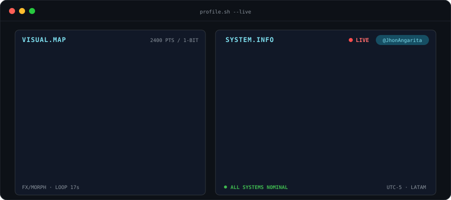

<h2>Building here since Forever</h2>

<!-- Descomenta y pon tus links:

-->

  

---

## Sobre mí :)

Hola, soy **Jhon Angarita**, **analista y desarrollador de software**. Me gusta construir aplicaciones web, trabajar con datos y convertirlos en soluciones útiles.

- 🔭 Trabajando en: **queens-be-alejandra**
- 🌱 Aprendiendo: _(escribe aquí qué estás aprendiendo)_
- ⚡ Dato curioso: _(algo sobre ti)_

---

<h2>Stack</h2>

 

---

<h2>signals</h2>

---

<h2>Numbers matter? ohhh yes.</h2>

 

---

Built with love · <b>@JhonAngarita</b>

